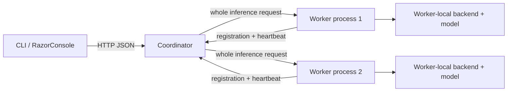

# Architecture / protocol v1



The executable is the same for coordinator and workers, but they always run in different OS processes. A worker owns its model and compute resources; the coordinator owns discovery and routing only. The TUI is a separate optional executable. DTO serialization uses `RpcJson`, without reflection-based fallback. The ASP.NET request delegate source generator enables Native AOT endpoints.

## Interfaces

`IComputeBackend` exposes `Kind`, `DiscoverDevices()` and cancellable `LoadModelAsync(ModelInfo, CancellationToken)`. `IInferenceModel` exposes model metadata, cancellable generation, and async disposal. `DeviceInfo.NativeAvailable` means discovery can access hardware; `SupportsInference` means compute is actually implemented. Those capabilities are independent. `ModelInfo` identifies an actually loaded model; real models are advertised only after weight/tokenizer loading and backend initialization succeed.

The contracts deliberately do not expose tensor pointers or pretend to support arbitrary model formats. Future loader/tensor/KV-cache abstractions should be introduced with explicit ownership, shape/dtype checks and versioning once real kernels exist. `MaxTokens` counts generated model tokens; for `synthetic-v1` it counts synthetic units. Real responses add token IDs, prompt token count, finish reason, completed GPU dispatch count and GPU compute time. All additions are optional/defaulted for protocol v1 compatibility.

## HTTP endpoints

All endpoints except `/health` check `X-DeepInfer-Token` when a token is configured. Use `DEEPINFER_TOKEN` to avoid putting secrets in process arguments.

| Role | Method / endpoint | Request / response |
|---|---|---|
| Both | GET `/health` | `HealthInfo`; role, status and protocol version |
| Coordinator | POST `/v1/workers/register` | `WorkerRegistration`; 204 on success |
| Coordinator | GET `/v1/workers` | `ClusterSnapshot`, including last-seen timestamps and health |
| Worker | GET `/v1/capabilities` | `WorkerRegistration` |
| Both | POST `/v1/infer` | `InferenceRequest` → `InferenceResult` |

Example request:

```json
{"prompt":"Hello","maxTokens":16,"model":"synthetic-v1","backend":"simulation"}
```

Success contains request ID, worker ID, model/backend, text, synthetic units in `tokens`, `isSimulation` and worker compute milliseconds. Coordinator forwarding preserves the worker's response. Model-specific input errors retain HTTP 400. Errors use `RpcError` (`code`, `message`) for application validation, authorization and dispatch failures. ASP.NET itself handles malformed JSON/body-limit errors and may use a different or empty body.

Limits: protocol version 1; non-whitespace prompts. Qwen3.6 allows up to 8,388,608 UTF-16 characters and 262,144 total input/output tokens; simulation retains 32,768 characters / 256 outputs. The HTTP envelope is capped at 64 MiB; worker capacity 1–64; registry bounded to 1024 entries with expired-entry cleanup on registration. Device/model arrays are bounded to 32 elements each. Endpoint origins must be HTTP(S), without credentials, paths, query strings or fragments. Loopback-only registration is the default.

## Lifetime and failure behavior

Workers register after opening their HTTP listener, then refresh every 2 seconds. Failed registration is retried, with a 3-second request deadline. Coordinator health is derived from an 8-second lease using `TimeProvider`. A failed inference does not extend or revoke a lease. Expired workers appear unhealthy until a later registration prunes them. Re-registration restores a worker; the coordinator can restart independently.

Routing selects live advertisements matching model ID and an implemented backend, then rotates among them. Worker semaphores enforce local capacity without queueing; coordinator selection does not track in-flight load. It does not retry rejected/dispatched inference. Model execution receives request cancellation; downstream inference calls time out after 24 hours for long workloads; heartbeat calls retain a three-second timeout. Synthetic generation checks cancellation per unit. Real generation runs on a worker task and checks cancellation during tokenization and between transformer layers/tokens. A submitted Metal command completes before cancellation is observed; device work is not forcibly interrupted.

| Condition | Status |
|---|---|
| Invalid request/registration | 400 |
| Invalid/missing configured token | 401 |
| Body too large | 413 |
| Worker has no free slot | 429 |
| Direct worker has no loaded model/backend | 501 |
| Selected worker unreachable/failed | 502 |
| No eligible live worker | 503 |
| Downstream RPC timeout | 504 |

`demo` launches child processes, drains their logs, waits for registration, exercises inference, benchmarks and reaps every child in `finally`. `--stay` keeps the cluster online until Ctrl+C or a child exits. SIGINT and SIGTERM are supported clean shutdown paths for the demo parent; forced parent termination cannot guarantee cleanup. Independent servers handle SIGTERM through ASP.NET host shutdown.

No tensor parallelism, expert parallelism, collective transport, remote memory or checkpoint migration is implemented. HTTP JSON is the control/request plane for v0.1; a future tensor data plane can be added without sending raw device addresses between processes.

## Supported model

Qwen3.6-35B-A3B is the only supported real model. The dense Qwen2.5 and TinyStories loaders, CPU model backend and dedicated download/verification tools have been removed. The Metal loader requires the exact model ID and `mlx-qwen36-affine` format. CLI/demo defaults use its 8bit checkpoint; the same model's 5bit checkpoint remains supported. `synthetic-v1` remains an explicit weight-free RPC test fixture, with protocol-v1 DTO defaults preserved for compatibility.

Real workers require capacity 1; independent workers own separate replicas. CPU matrix primitives remain for numerical tests. CUDA is used by the Qwen3.6 prefix agent, rather than a generic full-model worker.

## Qwen3.6-35B-A3B quantized MoE execution

`Qwen36Model` implements the pinned 40-layer/2048-hidden text architecture. It accepts `mlx-qwen36-affine`, a checkpoint layout, through the existing model/backend contracts. `Qwen36Weights` validates geometry and shapes; reads U32 packed matrices and BF16 affine parameters directly into owned Metal buffers; and ignores the unused vision weights after validating shard metadata. All 256 experts have persistent owned Metal buffers; the engine does not load/offload experts on demand. Physical residency can still be affected by macOS memory pressure and swap. Top-8 routing chooses rows from the expert stacks, with an independent sigmoid-gated shared expert. No external inference runtime is linked or invoked.

The default `Qwen36Gpu` / `gpu_graph.mm` path executes an entire token forward in one Metal command buffer. Embedding dequantization, all 40 layers, normalization, depthwise convolution/SiLU, Gated DeltaNet, partial RoPE, gated causal full attention, Top-8 routing, shared and selected expert SwiGLU, residual merging and classifier argmax stay on the GPU. C# owns tokenization, the greedy generation loop, cancellation and RPC. Only the next token ID returns during normal decoding; full logits and hidden states are copied only for explicit verification. The graph retains strong references to weight buffers independently of the managed matrix wrappers.

Thirty layers use linear attention with 32 value heads / 16 key heads, dimension 128; every fourth layer uses gated full attention with 16 query heads / 2 KV heads, dimension 256. Convolution history and recurrent state are reset before every request. KV storage is reused: position restarts at zero, each new prefix overwrites its entries, and attention only reads through the current position. A model gate serializes requests and verification. Cancellation is observed between at most 2048-token outer prefill chunks and between decode tokens; an already committed GPU command cannot be interrupted.

A short-context decode forward completes 675 kernel dispatches and one submission/wait. At positions >= 2048, each full-attention layer adds a partition-combine kernel, for 685 dispatches total; submissions remain one per forward. The default `gpu_prefill.mm` path processes up to 2048 prompt tokens per layer before advancing to the next layer. Full-attention queries use subtiles of at most 128 so workspace stays bounded. The preceding base chunk has 672 kernels; grouping/indirect grids add 80, chunkwise DeltaNet adds 30, and attention query subtiles add 20 for each additional subtile. Grouping and chunkwise DeltaNet activate only for chunks of at least 64 tokens. Thus a complete 2048-token chunk has 1082 kernels, plus three classifier/argmax kernels only on the final chunk. A 24-input / 128-output request still uses the short paths and completes 86,400 kernels / 128 submissions. The concurrent encoder overlaps independent projections; explicit buffer barriers order dependent stages. Intermediate tensors, recurrent state and KV remain in native Metal buffers.

Prefill projections use original FP32 `simdgroup_float8x8` matrix instructions. Each threadgroup covers 64 output rows and an adaptive 8/16/24/32-token tile with a 32-column inner tile. Packed 5/8-bit weights are unpacked into bounded threadgroup memory, reused across the token tile, and discarded after the block. There is no persistent expanded-weight cache and no external GEMM/inference library. Tiny projections and shared-expert gate/up retain a four-vector kernel. Selected experts now use GPU-only route compaction followed by indirect grouped GEMM: 64 output rows, 16 routed tokens and a 32-column inner tile. Eight adjacent quantized codes are unpacked together. Fused gate/up emits SwiGLU directly, while down scatters into the original token/slot layout. Each token retains its own Top-8 IDs and probabilities; no CPU route readback or sorting is used.

Batch convolution reads previous-chunk history and current-chunk raw projections. DeltaNet prepares independent 32-token head/block matrices using a stable triangular solve, then computes corrections, outputs and state updates with FP32 matrix operations. Only the 32-token block boundaries remain sequential. State stays in registers across blocks and is stored once, together with the last three convolution entries. Direct decay products avoid division by zero/underflow; a cancelling Neumann expansion was rejected by numerical regression. Full attention prepares Q/K norms/RoPE/KV in one batch and uses the exact `chunkBase + tokenOffset` causal boundary. Long prefill fuses QK, online softmax and PV over 1024-key partitions. Four query tokens and eight GQA heads share each 32-key KV tile, with FP32 SIMD matrix instructions and register accumulators for all 256 value features. Only partial maxima, sums and weighted values are written; the existing stable combine stage also applies the output gate. Short attention retains its measured score path with a bounded 2048-key stride. Normalization, routing and merging are batched too. Each full-attention layer processes its queries in at most 128-token subtiles with exact per-tile Q/gate/output offsets and causal positions. Only the final chunk runs the classifier. Prefill shaders and bounded scratch are initialized during model loading; large trace scratch is allocated only when explicit tracing requests it; no prefix-result cache or speculative decoding is used.

The decode GEMV assigns one SIMD group per output row, with four rows per 128-thread group (one row/32 threads for tiny matrices). Each lane loads two packed words for eight adjacent codes, aligns their bit window once, then extracts codes at constant positions. This removes repeated cross-word branches. BF16 affine parameters are reused; column counts not divisible by 256 use the earlier two-value loop. All stored weights remain 5/8-bit and activations/state/accumulation remain FP32. Row-tail checks apply to whole SIMD groups; a 2D grid selects expert slots with separate down-projection input vectors.

Top-8 uses stable lowest-index tie breaking and renormalizes the chosen scores. GPU argmax also chooses the lowest index on ties and rejects non-finite classifier values. Floating-point reduction order differs from the CPU executor. A near tie at the eighth/ninth expert boundary can therefore change a discrete routing choice; fixed-routing diagnostics isolate continuous operator accuracy from this discontinuity. Those diagnostics do not establish bitwise identity for arbitrary long prompts.

The preceding C# layer executor remains available with `DEEPINFER_METAL_HOST_EXECUTOR=1` (501 kernels / 191 submissions per decode forward). `DEEPINFER_METAL_GENERIC=1` selects the original GEMV; `DEEPINFER_METAL_EXPERT_UNFUSED=1` retains separate expert projections and CPU activation (541/231); `DEEPINFER_METAL_SERIAL=1` also disables batching and expert fusion (541/541). These three legacy switches select the host executor automatically. `DEEPINFER_METAL_VECTOR_QUANT=0` selects the preceding unpack loop; `DEEPINFER_METAL_SERIAL_GRAPH=1` selects a serial complete-GPU encoder; `DEEPINFER_METAL_ROW_TILE=8` is a measured alternative, while four rows remain the default.

`DEEPINFER_METAL_PREFILL_CHUNK` accepts 32/64/128/256/512/1024/2048; default is 2048. `DEEPINFER_METAL_PREFILL_EXPERTS=vector` restores per-token expert projections; default is `grouped`. `DEEPINFER_METAL_PREFILL_DELTA=sequential` restores the original recurrence; default is `chunked`. `DEEPINFER_METAL_PREFILL_ATTENTION=legacy` restores the materialized-score path for A/B measurements; `fused-all` forces fused attention even for short inputs during verification. `DEEPINFER_METAL_PREFILL_ATTENTION_FEATURES=64` or `128` are slower diagnostic tiles; the default covers all 256 features. `DEEPINFER_METAL_PREFILL=0` retains sequential token prefill. `DEEPINFER_METAL_PREFILL_MATRIX=0` keeps layer batching but selects the four-vector projection kernel. `DEEPINFER_METAL_PREFILL_ROWS=32` selects the measured smaller row tile; the default is 64. `DEEPINFER_METAL_PREFILL_TOKEN_TILE=8` or `32` fixes that tile for diagnostics, otherwise it adapts. Explicit `verify-qwen36 --prefill` evaluates and traces the batch path. Forced routing and router-debug capture use sequential generation; ordinary workers reject forced routing.

The batch API validates jobs before encoding, rejects duplicate/cross-device matrices and input/output dependencies, and retains/pins resources until completion. The fused expert API validates dimensions, precision, expert IDs, lengths and output non-overlap. Invalid calls submit no GPU work. `gpuSubmissions` counts completed command buffers, distinct from completed kernels in `gpuDispatches`. `gpuComputeMs` sums command-buffer GPU intervals and can include dispatch gaps; it is not kernel-only hardware profiling.

Long attention retains FP32 KV. The ten full-attention layers require 40,960 cache bytes per capacity token (10 GiB at 262,144). `di_graph_reserve` grows capacity in powers of two between requests after reset; existing history is discarded, never shared between requests. Buffers retain the largest allocation until model disposal. KV grows one layer at a time to avoid retaining two complete old/new caches. Attention score strides follow capacity, including for subsequent short requests. Long softmax uses 1024-key partitions and a numerically stable combination of maxima, sums and weighted values; each threadgroup has bounded scratch. Default prefill score scratch is bounded to 16 MiB for 128 queries and 2048 keys. At maximum context, partition statistics for 128 queries require 516 MiB, shared with decode; decode score scratch is another 16 MiB. Fused prefill avoids materializing long attention scores and shares KV reads across query heads/tokens. Dense full attention still performs quadratic work as input grows; no subquadratic attention approximation is used. The explicit legacy score mode is also tiled to at most 128 queries, bounding its maximum score scratch to 2 GiB (512 MiB with an outer chunk of 32). Larger outer chunks no longer multiply partition workspace. Outer chunks up to 2048 do increase projection and expert activation scratch. Cancellation waits for the complete submitted outer chunk, so larger chunks can increase cancellation latency.

`InferenceRequest.Profile=true` records non-overlapping 256-interval decode windows, cache capacity/bytes and actual Metal allocation bytes. Worker logs show prompt progress every 1024 tokens and decode progress per window. `BenchmarkIgnoreEos=true` is an explicit Qwen3.6-only fixed-length throughput diagnostic; default generation always honors EOS. Such runs do not establish natural-output quality or length. The HTTP response remains non-streaming; first-token timing is internal to the worker.

The tokenizer uses Qwen3.6's NFC/combining-mark-aware regex and exact non-thinking single-turn template. User text cannot inject control IDs. Execution is greedy, with up to 262,144 total tokens and at most 32,768 output tokens. This is the pinned unscaled RoPE configuration limit; end-to-end performance at that maximum is not established merely by enabling the capacity. Input and output share the context budget. There is no vision, MTP, YaRN, continuous batching or model-internal rank communication.

An optional independent MLX-LM process creates FP32 oracle artifacts and exits before this engine loads weights. `verify-qwen36` checks tokenizer and greedy token IDs and exports per-layer traces; `compare-qwen36.py` checks numerical tolerances without MLX. `--trace-all` exports every layer state; host-only `--route-trace PATH` exports expert choices. `DEEPINFER_GRAPH_FORCE_ROUTES` is accepted only by explicit verification and rejected by ordinary model workers. It is never used in performance measurements. Router debug captures and optional GPU timestamp sampling are diagnostics; this M5 does not expose per-dispatch timestamp sampling through the attempted Metal counter API.

The stable device/model/RPC contracts remain unchanged. Whole-request replica routing and the dedicated Qwen3.6 split service remain available.

## Decode phase timing

InferenceResult/ModelOutput add optional `InferenceTimings` without changing protocol v1. Timing begins inside the worker after acquiring the model gate. Prompt forwards are timed separately; decode starts after the first emitted token, ends after the last emitted token, and counts N−1 output intervals. A final forward/argmax that discovers EOS is excluded from decode. Empty/single-output responses report zero decode intervals/rate. Benchmark aggregation divides total decoded intervals by summed decode time, rather than averaging rates.

An opt-in mixed-precision variant adds original Metal 4 MPP BF16 operand GEMM for batched dense/grouped expert projections, retaining FP32 accumulators and activation buffers. A separate BF16 KV option halves the persistent full-attention cache allocation and is used consistently by prefill and decode. Defaults remain FP32; see [BF16 Metal](BF16-METAL.md) for exact boundaries, hardware requirements and evidence.

The measured M5 MoE launcher profile now uses bounded BF16 expansion for dense/shared projections (including 32-row decay/beta matrices), packed 64-route expert inputs with 32-row/64-column expert tiles (two SIMD groups for gate/up, one for down), and BF16 attention with 128-key blocks (16 SIMD groups for batches of at least 32 queries, four for tiny/decode batches). Decode reuses fused GQA attention and avoids materializing scores. State/residual/normalization remain FP32. See [current prefill measurements](PREFILL-TUNING.md) for precision boundaries and matched MLX results; prefill parity has not been reached.
